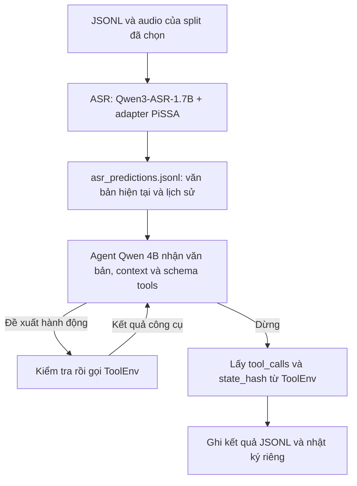

# LifeMate — ASR và agent

## Bắt đầu với LifeMate

Luồng đã nối: **audio → ASR PiSSA → `asr_predictions.jsonl` → agent Qwen → ToolEnv → kết quả JSONL**.
ASR và agent bàn giao qua file, có thể chạy bằng hai môi trường Python khác nhau.
Nếu đã có adapter ASR được huấn luyện, bạn chạy nhận dạng trực tiếp; không cần
huấn luyện lại để tạo prediction.
Phần nối đã có test; suy luận ASR/Qwen thật trên GPU chưa được xác minh.
`load_toolenv()` đã nối runtime BTC của đúng split và vẫn là hook để nhóm trưởng cấu hình.

| Bạn muốn làm gì? | Mở file nào? |
|---|---|
| Sinh văn bản cho yêu cầu hiện tại và các lượt người dùng trong lịch sử | [notebooks/lifemate/predict_asr.py](notebooks/lifemate/predict_asr.py) |
| Chạy agent từ text ASR | [notebooks/lifemate/run_agent.ipynb](notebooks/lifemate/run_agent.ipynb) |
| Sửa hướng dẫn cho model, quyết định gọi công cụ, vòng lặp hoặc nối ToolEnv | [src/lifemate/agent.py](src/lifemate/agent.py) |
| Hiểu từng hàm, định dạng và cách bàn giao | [docs/lifemate/README.md](docs/lifemate/README.md) |
| Validate/evaluate agent, chia dev/test và xem lỗi tool/arguments/state | [docs/lifemate/agent-evaluation.md](docs/lifemate/agent-evaluation.md) |

### Cấu trúc repo

```text
ZAIC-76Vibecoders/
├── README.md                          # Bản đồ repo và thứ tự chạy
├── pyproject.toml                     # Khai báo gói Python và thư viện phụ thuộc
├── notebooks/
│   └── lifemate/
│       ├── predict_asr.py             # Bước 1: chạy ASR; chia cell bằng # %% cho Kaggle
│       └── run_agent.ipynb            # Bước 2: cấu hình và gọi agent; không sao chép mã xử lý
├── src/
│   ├── lifemate/                      # Mã tích hợp ASR → agent
│   │   ├── agent.py                   # Nạp Qwen, tạo đầu vào, chọn/gọi công cụ, xuất kết quả
│   │   ├── paths.py                   # Đường dẫn chung cho cả hai bước
│   │   └── asr/
│   │       ├── predict.py             # Dùng ASR có sẵn; lưu bộ nhớ đệm và xuất file
│   │       └── predictions.py         # Ghép yêu cầu/lịch sử, kiểm tra định dạng, đọc file
│   ├── asr_benchmark/                 # Đánh giá, so sánh model ASR và các adapter
│   └── asr_finetuning/                # Huấn luyện ASR PiSSA + CE/SCST
├── tests/
│   └── lifemate/                      # Kiểm thử định dạng, luồng tích hợp và đường dẫn chạy
├── docs/
│   └── lifemate/README.md             # Luồng xử lý và bảng chức năng chi tiết
├── requirements/                      # Thư viện cho môi trường ASR và đánh giá adapter
├── benchmark-base-asr-model.ipynb     # Notebook benchmark ASR ban đầu của đội
└── output/
    ├── jupyter-notebook/              # Các notebook khảo sát/benchmark adapter cũ
    └── lifemate/                      # Kết quả LifeMate sinh khi chạy
        ├── asr/<split>/
        │   ├── asr_predictions.jsonl  # Văn bản ASR hoàn chỉnh đưa cho agent
        │   ├── audio_predictions.jsonl # Bộ nhớ đệm kết quả nhận dạng từng audio
        │   └── prediction_metadata.json # Danh tính dữ liệu, cấu hình và model
        └── agent/<run_id>/            # Kết quả JSONL và nhật ký từng mẫu
```

## Luồng chạy LifeMate



Ba nhóm code có tên theo chức năng: `asr_benchmark` để đánh giá model,
`asr_finetuning` để huấn luyện, `lifemate` để nối ASR với agent. Gói mẫu đã xóa
không còn trong cấu hình cài đặt hoặc danh sách lệnh chạy. Sau khi cài dự án,
lệnh `lifemate-agent` gọi chương trình điều phối agent; `asr-benchmark` chạy
phần đánh giá ASR.
Trong `asr_finetuning/`, `zaic_pissa/` là gói huấn luyện PiSSA độc lập,
dùng môi trường Python riêng như hướng dẫn của phần huấn luyện.

### Bước 1 — Chuẩn bị mã nguồn, dữ liệu và trọng số

Chuẩn bị ba phần:

| Thành phần | Yêu cầu |
|---|---|
| Mã nguồn | Toàn bộ bản mới của repo, có `src/lifemate/` và `src/asr_benchmark/`. Notebook agent cần các module này để import. |
| Dữ liệu | `DATA_ROOT` trỏ tới thư mục chứa `train/`, `public_test/` và các file/audio bên trong. |
| Trọng số | Base ASR 1.7B, adapter PiSSA đã huấn luyện, và model/tokenizer Qwen agent 4B. |

Các script lấy mã nguồn hiện tại từ nhánh `agent`; nếu dùng GitHub trên Kaggle,
cần đưa bản đổi tên lên nhánh đó trước. Riêng script đánh giá adapter khóa SHA
cũ vẫn nhận diện cấu trúc của commit cũ để giữ nguyên thí nghiệm đã khóa phiên bản.

Môi trường ASR PiSSA dùng thư viện theo
[`requirements/qwen-adapter-benchmark.txt`](requirements/qwen-adapter-benchmark.txt).
ASR và agent có thể chạy bằng hai môi trường riêng vì trao đổi bằng JSONL.
Gói `.[asr]` ở phần benchmark phía dưới dành cho bộ baseline SDK, không phải
hướng dẫn cài môi trường PiSSA này.

Trên Kaggle cần có cả mã nguồn của repo. Nếu repo không nằm trong thư mục hiện
tại hoặc thư mục cha, đặt `ZAIC_PROJECT_ROOT` tới thư mục repo. Script và notebook
tự tìm repo từ vị trí đó. Trọng số mặc định được nạp từ thư mục local hoặc cache;
phần tích hợp không tự tải model hay cài lại PyTorch.

### Bước 2 — Chạy ASR để tạo văn bản

Mở [notebooks/lifemate/predict_asr.py](notebooks/lifemate/predict_asr.py), sửa các
biến trong `main()`:

| Biến | Ý nghĩa |
|---|---|
| `DATA_ROOT` | Thư mục gốc dữ liệu; local thường là `C:/zalo_ai/train+public_test`. |
| `SPLIT` | `train` hoặc `public_test`; chạy toàn bộ split đã chọn. |
| `MODEL_CONFIG` | Cấu hình ASR; mặc định là `src/asr_benchmark/configs/models/qwen_vimd_pissa_full.json`. |
| `MODEL_PATH` | Đường dẫn base ASR; `None` để tìm trong Hugging Face cache. |
| `ADAPTER_PATH` | Đường dẫn adapter đã train; `None` dùng đường dẫn trong cấu hình. |

Cấu hình mặc định trỏ tới **adapter PiSSA full ViMD**. Nếu dùng kết quả fine-tune
trên Zalo, đặt `ADAPTER_PATH` tới `best_adapter/` của đúng lượt train đó.

Từ repo root, chạy bằng Python của môi trường ASR đã chuẩn bị:

```text
python notebooks/lifemate/predict_asr.py
```

Trên Kaggle, script có các cell `# %%` để mở và chạy trong notebook. Dữ liệu
mặc định là `/kaggle/input/datasets/khangl123/zalo-ai/train+public_test`; sửa
`DATA_ROOT` nếu đường dẫn gắn dữ liệu khác.

ASR nhận dạng cả audio yêu cầu hiện tại và mọi audio người dùng trong lịch sử.
Chương trình nạp ASR một lần và giải phóng model khi xong. File bàn giao hoàn chỉnh
là `asr_predictions.jsonl`; `audio_predictions.jsonl` chỉ là bộ nhớ đệm từng audio
để tiếp tục khi bị ngắt.

### Bước 3 — Kiểm tra file ASR bàn giao

| Nơi chạy | File ASR tạo ra và agent sẽ đọc |
|---|---|
| Local | `<repo>/output/lifemate/asr/<split>/asr_predictions.jsonl` |
| Kaggle | `/kaggle/working/lifemate/asr/<split>/asr_predictions.jsonl` |

File hoàn chỉnh chỉ được tạo sau khi đủ prediction của cả yêu cầu hiện tại và
lịch sử. Mỗi dòng có dạng:

```json
{"id":"example_0001","current_text":"Yêu cầu nhận dạng được","history_user_texts":[{"history_index":1,"text":"Lời nhận dạng từ lịch sử"}]}
```

`history_index` là vị trí trong mảng `history` gốc, tính từ 0 và tính cả lượt
assistant. Không có lượt user trong lịch sử thì dùng `history_user_texts: []`.
Đây là định dạng nội bộ ASR → agent, chưa phải file nộp BTC. Không lấy `audio_text`,
`reference` hoặc `label` để điền thay prediction bị thiếu.

Nếu đã có file ASR hoàn chỉnh cho đúng split, có thể bắt đầu từ bước tiếp theo.

### Bước 4 — Kiểm tra đường dẫn ToolEnv

Trong [src/lifemate/agent.py](src/lifemate/agent.py), `load_toolenv()` đã nạp
thư viện BTC của đúng split và trả về hàm tạo ToolEnv theo ID.
Runner chỉ tạo một môi trường cho mỗi mẫu; các hành động trong history đã được
môi trường khởi tạo sẵn, không gọi lại.

Kiểm tra `DATA_ROOT/<split>/zaic_tools` tồn tại. Không đọc trực tiếp `*_environment`
hay `state.json` để thay cho API công cụ.

### Bước 5 — Chạy notebook agent

Mở [notebooks/lifemate/run_agent.ipynb](notebooks/lifemate/run_agent.ipynb), chạy
các cell từ trên xuống và kiểm tra:

- `DATA_ROOT`: cùng bộ dữ liệu đã dùng ở bước ASR.
- `SPLIT`: cùng split đã nhận dạng.
- `MODEL_SOURCE`: model/tokenizer agent Qwen 4B đã có trong local hoặc cache.
- `ASR_FILE`: file prediction được in ra ở cell cấu hình.
- `AGENT_OUTPUT`: thư mục ghi kết quả agent.

Notebook chỉ cấu hình và import code từ `src/lifemate/agent.py`. Chương trình nạp
Qwen một lần, lấy văn bản ASR theo ID rồi xử lý toàn bộ split. Trong mỗi yêu cầu,
agent lặp: tạo đầu vào → Qwen đề xuất → kiểm tra → gọi công cụ → đọc kết quả →
quyết định bước tiếp theo, cho tới khi dừng.

Các đường dẫn mặc định của luồng agent nằm trong `src/lifemate/paths.py`:

| Cấu hình | Local Windows | Kaggle |
|---|---|---|
| `DATA_ROOT` | `C:/zalo_ai/train+public_test` | `/kaggle/input/datasets/khangl123/zalo-ai/train+public_test` |
| `ASR_FILE` | `<repo>/output/lifemate/asr/<split>/asr_predictions.jsonl` | `/kaggle/working/lifemate/asr/<split>/asr_predictions.jsonl` |
| `AGENT_OUTPUT` | `<repo>/output/lifemate/agent` | `/kaggle/working/lifemate/agent` |
| `MODEL_SOURCE` | Thư mục Qwen 4B + tokenizer có thật, hoặc model ID đã cache | Thư mục Qwen 4B + tokenizer đã Add Input, hoặc model ID đã cache |

`DATA_ROOT` phải là thư mục cha chứa `train/`, `public_test/`. Runner tự ghép
`<split>/<split>.jsonl`, `<split>/<split>_tools_catalog.json` và
`<split>/zaic_tools/`. Đổi vị trí dữ liệu bằng cách gán `DATA_ROOT = Path("...")`
trong cell cấu hình, hoặc đặt biến môi trường `LIFEMATE_DATA_ROOT` trước cell này.

`ASR_FILE` mặc định khớp với bước nhận dạng khi chạy cùng máy/phiên và cùng split.
Nếu tải file từ Kaggle về local, sửa `ASR_FILE` tới file vừa tải. Nếu dùng file từ
notebook Kaggle khác, Add Input chứa kết quả đó rồi sửa `ASR_FILE` tới file dưới
`/kaggle/input/...`. Agent chỉ đọc file bàn giao; không tự chạy ASR hay chuyển file.
Kaggle ghi kết quả vào `/kaggle/working`; `/kaggle/input` chỉ dùng để đọc.

`MODEL_SOURCE` mặc định là `Qwen/Qwen3-4B-Instruct-2507` với
`local_files_only=True`: cần đủ checkpoint/tokenizer trong cache của chính máy
đang chạy, hoặc thay bằng đường dẫn thư mục model đã chuẩn bị. Runner không tải
model qua mạng trong cấu hình này.

Notebook cần truy cập được repo source; nếu nằm ngoài repo, đặt biến môi trường
`ZAIC_PROJECT_ROOT` tới repo trước cell import. Biến này khác `DATA_ROOT`.
Có thể chạy entry point `lifemate-agent` sau khi cài package; cấu hình tương ứng
nằm ngay trong `src/lifemate/agent.py::main()`, vẫn chạy toàn bộ split.
Khi đổi `SPLIT`, chạy lại cell cấu hình để cập nhật đường dẫn. Sau khi sửa code
`.py`, khởi động lại kernel để notebook dùng phiên bản mới.

### Bước 6 — Lấy kết quả và đọc nhật ký

| Nơi chạy | Thư mục kết quả agent |
|---|---|
| Local | `<repo>/output/lifemate/agent/<run_id>/` |
| Kaggle | `/kaggle/working/lifemate/agent/<run_id>/` |

Mỗi lần chạy tạo một thư mục riêng:

- `debug_train.jsonl`: kết quả chạy trên train; một phần split khác cũng mang tên debug.
- `submission.jsonl`: tên dùng khi đã ghi đủ ID của toàn bộ split ngoài train.
- `traces/`: nhật ký output model, quyết định gọi công cụ và kết quả thực thi theo mẫu.

Dòng kết quả có đúng `id`, `tool_calls`, `state_hash`. Log và hash lấy từ chính
ToolEnv; giữ mọi call thực tế, kể cả call bị runtime từ chối. Trạng thái `finished`
chỉ cho biết model tự kết thúc, chưa chứng minh câu trả lời đúng.

Luồng ASR tính trước qua file phục vụ phát triển và kiểm tra riêng từng phần.
Thời gian đọc file trong agent không phải thời gian nhận dạng ASR thật. Khi đo
end-to-end hoặc đóng gói chương trình cuối, cần tính cả ASR và agent. Repo chưa
xác minh suy luận GPU hoàn chỉnh hoặc thời gian thi bằng luồng này.

## Kiểm tra phần LifeMate

Từ repo root, PowerShell:

```powershell
$env:PYTHONPATH = "src"
python -m unittest discover -s tests/lifemate -p "test_*.py" -v
```

Đặt thêm `LIFEMATE_DATA_ROOT` tới dữ liệu BTC để chạy test ToolEnv thật. Phần ASR
và LLM trong test dùng dữ liệu/phản hồi giả; test qua chưa chứng minh chất lượng
nhận dạng, quyết định agent hoặc giới hạn thời gian thi. Hướng dẫn chi tiết ở
[docs/lifemate/README.md](docs/lifemate/README.md).

## Đánh giá và so sánh các model ASR gốc

Phần đánh giá nằm trong `src/asr_benchmark`, so sánh PhoWhisper medium/large và
Qwen3-ASR 0.6B/1.7B trên tập train. Kết quả gồm CER/WER trước và sau chuẩn hóa,
cùng thời gian nhận dạng. Trên Kaggle, các model chạy lần lượt; mỗi GPU T4 xử lý
một phần dữ liệu.

Cài dự án cùng nhóm thư viện ASR trong môi trường đã có PyTorch/CUDA phù hợp:

```bash
pip install '.[asr]'
```

Chuẩn bị danh sách mẫu và chia audio, sau đó giữ cùng một `run-id` khi chạy từng bước:

```bash
asr-benchmark prepare-dataset --environment local --run-id example
asr-benchmark download-models --environment local --run-id example
asr-benchmark transcribe --environment local --run-id example
asr-benchmark evaluate --environment local --run-id example
asr-benchmark compare --environment local --run-id example
```

Hoặc chạy cả năm bước theo thứ tự bằng một lệnh:

```bash
asr-benchmark benchmark --environment local --run-id example
```

Trên Kaggle, dùng `--environment kaggle` và sửa đường dẫn dữ liệu trong
`src/asr_benchmark/configs/environments/kaggle.json` tới thư mục chứa
`train.jsonl` và `audio/`. Nếu dùng token Hugging Face, thêm Kaggle Secret tên
`HF_TOKEN`. Notebook benchmark ban đầu là `benchmark-base-asr-model.ipynb` ở repo root.

Tiện ích `source_manager` tải các phần mã nguồn được chọn từ GitHub. Lệnh dọn dẹp
chỉ xóa thư mục mã nguồn có marker quản lý hợp lệ:

```bash
PYTHONPATH=src python -m asr_benchmark.source_manager.cli download
PYTHONPATH=src python -m asr_benchmark.source_manager.cli cleanup
```

Lệnh dọn dẹp được chạy riêng sau benchmark để bạn kiểm tra kết quả trước khi xóa
mã nguồn đã tải.

Test cho benchmark và trình quản lý mã nguồn nằm trong `src/asr_benchmark/tests/`.
Từ repo root trên PowerShell:

```powershell
$env:PYTHONPATH = "src"
python -m unittest discover -s src/asr_benchmark/tests/unit -p "test_*.py" -v
```

## Huấn luyện ASR và tài liệu chi tiết

- [Huấn luyện PiSSA + CE/SCST trên Zalo](src/asr_finetuning/README.md): dành cho
  thành viên phụ trách fine-tune; không bắt buộc chạy lại khi đã có adapter phù hợp.
- [So sánh adapter PiSSA và AdaLoRA](docs/benchmark-qwen-full-adapters.md).
- [Bảng hàm và luồng tích hợp LifeMate](docs/lifemate/README.md).
