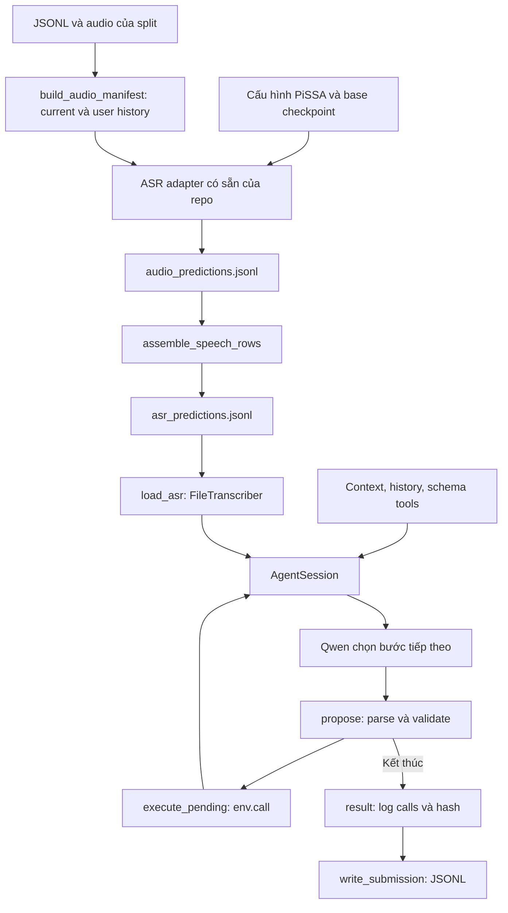

# ASR prediction → LifeMate agent

## Giao thức mặc định — btc-tool-call-v1

`AgentConfig()` dùng một vòng lặp: model chọn một tool call `{name, arguments}`
hoặc trả lời cuối. Parser nhận cùng một call ở dạng JSON trần hoặc native
`<tool_call>`. Code kiểm tra schema bằng `env.validate()`, nguồn ID, budget và
pending ticket rồi mới thực thi. Toàn bộ schema của các tool được phép có ngay từ
lượt đầu; không cần model sinh `tool_request` để mở schema và sinh lại call.
Không có lượt sinh plan/approval/recovery/finish JSON trong đường mặc định.
Giữ public API, một model dùng lại, một ToolEnv/mẫu và submission chuẩn của BTC.

```text
Request + history + context → source grounding view + tool schemas
  → một working brief: tách việc, nguồn arguments và phụ thuộc
  → model chọn call hoặc final
  → parse {name, arguments} → BTC schema/ID/budget guard
  → write check đối chiếu arguments/phụ thuộc (read không thêm lượt này)
  → cấp pending execution ID bằng code → execution.py gọi ToolEnv một lần
  → kiểm tra canonical log → immutable receipt + kết quả thật → lượt model tiếp
Final hoặc ask hợp lệ → checkpoint một lượt (call/final cùng giao thức)
  → call thay thế quay lại mọi guard; hoặc final/ask được chấp nhận
  → trạng thái phiên bằng code → get_tool_calls/get_state_hash → submission
```

`task_reasoning_enabled=True` bật `task_reasoning.py`. Model tạo một working brief
ngắn bằng văn bản: mỗi mục tiêu, tool phù hợp, các trường cần cho yêu cầu, nguồn
giá trị, lookup còn thiếu, điều kiện và việc tiền đề phải thành công. Đây không
phải DAG được parser thực thi, không có `base_version`/`operation_id` hoặc JSON
approval. Dependency được model đối chiếu với yêu cầu và kết quả thật; code quản
lý ngân sách, schema, receipt và pending execution, không chứng minh mọi quan hệ
ngữ nghĩa đều đúng. Brief là gợi ý có thể sai, không được đưa vào known ID/facts.

Chỉ tạo brief một lần, tối đa `planning_max_new_tokens=512`. Brief hỏng định dạng,
rỗng hoặc bị cắt thì bỏ và tiếp tục actor; không lặp sửa contract. Nếu planner đã
trả một native BTC call, call đó đi qua các guard và write check thông thường,
chưa được thực thi từ planning. Tất cả đều dùng cùng model đã nạp.

Trước mỗi write do actor đề xuất, một lượt `write_check` nhận schema thực của
candidate, bản kế hoạch và kết quả đã thực thi. Nó kiểm tra arguments cần theo
yêu cầu (kể cả trường optional trong schema), nguồn giá trị, đúng hành động/đối
tượng, điều kiện và phụ thuộc; trả cùng call hoặc call thay thế/final. Output vẫn
qua toàn bộ validator và không được review đệ quy. Call thay thế từ terminal
checkpoint đã được kiểm tra trong checkpoint, không thêm một write check nữa.

Tối đa `max_calls` lượt write check trên toàn mẫu; hết thì `write_check_limit`.
Planning và các check cùng tính vào `max_steps`/`max_seconds`; không tạo env mới.
Vì thêm một lượt trước hành động đầu và các lượt trước write, thời gian có thể
tăng. Đặt `task_reasoning_enabled=False` để đo đúng cấu hình trước thay đổi này.

`grounding_enabled=True` bổ sung một user-message dữ liệu ngắn trên mỗi lượt:
yêu cầu cuối nguyên văn, các chuỗi chữ số được trích kèm vị trí nguồn và tên/ID các
đối tượng đã quan sát. Hội thoại gốc không bị sửa; history vẫn là ngữ cảnh của các
thao tác đã xảy ra. Có tối đa 12 entity hints ưu tiên theo từ trùng yêu cầu; kết quả
tool đầy đủ vẫn được giữ trong hội thoại, không bị thay bằng bảng hints này.

`grounding.py` đối chiếu phone/phone_number/mobile với yêu cầu, public context,
history và kết quả thành công. Chuỗi đọc từng chữ số, có khoảng trắng hoặc chữ số
xen chữ được giữ đủ số 0 và độ dài; không tự áp quy tắc điện thoại 10 chữ số. Sửa
đầu/đuôi số chỉ được suy ra khi có số cũ và đoạn thay thế rõ ràng, giữ nguyên phần
không được yêu cầu sửa. Các số ứng viên có nguồn được đưa ra, không tự chọn liên hệ.
Guard không sửa arguments, không lấy dữ liệu từ call bị từ chối hay model tự kể.

Với filter hoặc ID có nguồn, guard chặn việc làm mất qualifier kề sát được nêu rõ
(nhỏ/lớn/chính/phụ, một số từ chỉ phía và chỉ số có từ "số"). ID được đối chiếu với
label thật từ kết quả tool cùng namespace. Nhiệt độ, phần trăm, thời gian, nhiều
đối tượng được yêu cầu cùng lúc hoặc trường hợp thiếu bằng chứng không bị đoán
thành ràng buộc đối tượng. Đây là kiểm tra từ vựng có giới hạn, không xác minh được
mọi tên đồng nghĩa, đại từ, điều kiện nghiệp vụ hay mapping nhiều mục tiêu.

Trace `diagnostics.first_model_input` lưu messages/tools thực sự truyền vào backend
ở lần sinh đầu và SHA256 của chúng; đây chưa phải chuỗi sau tokenizer chat template.
`call_protocol.grounding_context` lưu bảng nguồn gần nhất; event rejected có
`grounding` chứa trường lỗi và đoạn nguồn. Không thêm pha model hoặc đổi JSON call.
Đặt `grounding_enabled=False` để so với cùng giao thức trước bước cải thiện này.

`quantities.py` thêm `money_quantities` có nguyên văn, vị trí và giá trị VND:
ví dụ `75 ngàn` → `75000`. Guard chỉ đối chiếu `amount` kiểu số của write khi
yêu cầu có một số tiền trực tiếp, không có dấu hiệu nhiều việc, điều kiện,
phép tính hay sửa số tiền. Số đếm, tên riêng và cách nói chưa phân tích chắc chắn
không bị biến thành tiền. Nhiều số tiền chỉ là hints, không tự gán vào từng việc.
Arguments sai bị từ chối kèm nguồn; model đề xuất lại, code không tự sửa giá trị.

`checkpoint.py` chạy trước final hoặc `sys.ask_missing_info` đã qua schema guard.
Model nhận yêu cầu gốc, history/context, schema và kết quả thật để xem còn việc
nào chưa làm hoặc dữ liệu nào còn tra cứu được. Output vẫn chỉ là tool call
`{name, arguments}` hoặc final. Call thay thế phải qua toàn bộ validator/grounding
và chỉ `execution.py` được thực thi. Không thêm plan/approve/decision JSON.

Mặc định `terminal_check_enabled=True`, `max_terminal_checks=2` cho toàn mẫu.
Không kiểm tra đệ quy output của checkpoint; mỗi lượt tính vào cùng `max_steps`
và `max_seconds`, cùng giới hạn từ chối. Hết hai lượt mà lại cần checkpoint thì
dừng `checkpoint_limit`, không chấp nhận final chưa kiểm tra. `reviewed=True`
chỉ cho biết final đã qua model checkpoint/write check; `semantic_completion_verified` vẫn false.
Model có thể tiếp tục hiểu sai; checkpoint không bảo đảm hoàn thành đúng và
không ngăn mọi write sai trước khi tới terminal candidate. Đặt
`terminal_check_enabled=False` để đo riêng baseline/grounding.

`protocol.py` sở hữu pending execution ID, receipt và trạng thái; model không sinh
`base_version`, `depends_on`, `postcondition`, `operation_id` hay approval JSON.
Preview lặp lại dùng cùng pending ticket; ticket bị đổi hoặc đã tiêu thụ không được
thực thi. `sys.ask_missing_info` là tool BTC bình thường và dừng ở waiting_for_user.
Output lỗi đi qua một đường feedback ngắn với tối đa `max_invalid_replies` lần
liên tiếp (mặc định 2 lần sinh sai, tức một lần sửa). Không có decision JSON để sửa
giao thức điều phối. Chiến lược recovery nghiệp vụ nâng cao để sau lần test accuracy.

`call_repair.py` tổng quát hóa nhánh recovery sửa tool call. Validator BTC vẫn là
nguồn quyết định schema; code chỉ bổ sung feedback `repair` vào message/event bị
từ chối: mã lỗi, tool đích, tên parameter hợp lệ/bắt buộc, nhóm `x-one-of`, schema
đã bỏ ví dụ, lookup hints và budget còn lại. Tool không được phép nhận allowlist
thực tế; tên gần giống chỉ là gợi ý chính tả, không tự thay thế hành động.

Với `sys.ask_missing_info`, lỗi target không được phép, params không phải array
và tên params không thuộc schema target được báo riêng. Target hợp lệ không bị
gọi nhầm là "tool không được phép". `params` phải là input của target chứ không
phải dữ liệu muốn lấy từ output. Feedback target không tự kết luận mọi required
field đều đang thiếu trong yêu cầu người dùng. Code không tự điền/đổi arguments,
không tự gọi tool hoặc sinh JSON quyết định recovery; model đề xuất lại cùng chuẩn
`{name, arguments}`. Giữ nguyên giới hạn từ chối liên tiếp, không thêm vòng lặp.

Write có exception/kết quả không hữu hạn được đánh dấu execution_uncertain và dừng
mẫu, không tự retry. Write có done=false/error vẫn có trong canonical log; nếu model
kết thúc khi chưa có kết quả thành công của chính call đó thì status=blocked. Call
khác không xóa lỗi của write trước. Read trả danh sách rỗng vẫn là dữ liệu, không tự
chứng minh nhánh điều kiện false. Kết quả read/no-op lặp giống nhau có giới hạn
max_no_progress. Chưa có tự động reconcile hay lập lại kế hoạch bằng giao thức khác.

`finished` chỉ là kết thúc phiên bình thường, không chứng minh đã hiểu đúng mọi mục
tiêu hoặc đúng điều kiện nghiệp vụ. `semantic_completion_verified=false` ghi rõ giới
hạn này trong trace. Chấm exact calls, call F1 và xem lỗi trên dữ liệu thật sau inference;
giữ cả call-only và exact+finished theo quy ước notebook, không coi đó là điểm BTC.
Trace lưu protocol, số lần bị từ chối, receipts và thời gian tới call đầu. Notebook
báo riêng `control_generations` (đường mặc định là 0), `action_generations` và
`terminal_check_generations`, `task_plan_generations`, `write_check_generations`.
`call_protocol.task_reasoning` lưu brief, trạng thái và số lượt write check.
`call_protocol.repair_version`, `terminal_checks`,
event `repair.version` và bundle SHA in trước khi chạy giúp xác minh kernel đã nạp
đúng code. Checkpoint không có control JSON nhưng có thêm lượt inference.

Các cờ review_writes/review_finish/route_tools/adaptive_controller thuộc controller
lịch sử, không bật model review trong btc-tool-call-v1. Để đối chiếu có chủ đích:
`unified_protocol=False` chọn recovery-v3; thêm `adaptive_controller=False` chọn v2;
`workflow_enabled=False` chọn native baseline. Không dùng các lựa chọn lịch sử cho
đợt test giao thức mặc định mới. Ablation đo lần lượt baseline, grounding,
checkpoint và task reasoning/write check; tất cả vẫn cùng grammar tool call.

## Controller lịch sử — recovery-json-v3 (opt-in)

Phần dưới mô tả controller cũ với `AgentConfig(unified_protocol=False)`.

```text
Request/history bất biến → đề xuất interpretation + plan → validate/commit version
  → chọn ready step → actor đề xuất call → schema/ID/readiness guard
  → duyệt trước write → execute một lần → append receipt → verify postcondition
  → cập nhật goal/step bằng code → bước tiếp theo hoặc kiểm tra kết thúc
Khi sai: classify → sửa output / retry / replan / reinterpret / ask / reconcile / stop
```

Request và user-history text được lưu riêng, không thay bằng goal do model diễn
giải. Mỗi goal có ID, loại kết quả, mô tả và source quote nguyên văn; plan có
`base_version`, các step gắn goal/tool, dependencies, `when`, `expected_arguments`,
`postcondition` và stable `operation_id` cho write. Replan giữ goal/source anchors;
reinterpret được sửa cách hiểu nhưng không xóa mục tiêu hoặc lịch sử thực thi.
Thiếu mục tiêu phải thêm goal có nguồn. Plan sai được kiểm tra toàn bộ trước khi
cài, không áp dụng một nửa revision. Pending call/version cũ bị chặn trước execute.

Model chỉ cần đề xuất `reason` ngắn, `goals` và `steps`. `proposals.py` biên dịch
đề xuất thành contract nội bộ: tự gắn version của lượt sinh, cấp operation ID ổn
định theo step và điền các trường protocol bị bỏ qua (`depends_on=[]`, `when=null`,
`expected_arguments={}`, `postcondition=null`). Step bắt buộc có `id`, `goal_id`,
`kind`, `tool`; goal vẫn phải có nguồn nguyên văn. Trường đã gửi sai kiểu không
được tự sửa: `depends_on=null` hoặc chuỗi vẫn bị từ chối; version legacy đã gửi
phải là số nguyên khớp snapshot. Trace `plan_revision.compiled_defaults` ghi các
trường code đã điền. Validator gom lỗi cấu trúc độc lập với đường dẫn trường và
hướng dẫn sửa, sau đó vẫn kiểm tra ngữ nghĩa, dependencies và tính bất biến của plan.

Khi chưa có dữ liệu để lập bước sau, giữ goal và dùng step `kind=deferred`,
`tool=null`, dependencies trỏ tới bước tra cứu. Deferred không thực thi, không tính
là hoàn thành và không thể che một thao tác ghi bằng bước đọc. Sau khi có observation,
model có thể dùng replan hiện tại để thay deferred bằng bước cụ thể, lấy predicate
và arguments từ dữ liệu thật. Khi mở rộng deferred, giữ step ID để giữ identity;
các write goal deferred từ plan đầu được dành operation ID theo cùng quy tắc cấp ID.
Step deferred không có arguments/postcondition; một
điều kiện đã chứng minh false có thể bỏ qua nhánh. Cơ chế recovery, các lựa chọn và
budget hiện tại chưa thay đổi; việc lập tiếp vẫn tiêu thụ budget replan hiện có.

Điều kiện/postcondition dùng JSON predicate có operator giới hạn, không `eval` code
model. Operands tham chiếu step/result path hoặc literal; mỗi phép so sánh phải
tham chiếu dữ liệu quan sát. Thiếu field, lookup rỗng không có thuộc tính cần đọc,
hoặc toán hạng số sai kiểu cho kết quả unknown. Unknown không cho phép write hay
skip; false skip nhánh phụ thuộc; true cùng dependencies done mới tạo ready step.
Task đọc xác định điều kiện không được phụ thuộc chính câu trả lời của nó.
`maintain` cần điều kiện/postcondition có observation, không phát sinh write.

Không có full-ledger model review sau mỗi call. Code gắn receipt với step, goal,
operation và plan version rồi xác minh kết quả. Model chỉ đề xuất các quyết định
nhỏ: retry, replan, reinterpret, ask, stop, finish, answer hoặc reconcile. Write
approval là contract riêng `decision/plan_version/step_id/reason`; không yêu cầu
kết quả của call chưa chạy. Hoàn thành write cần receipt phù hợp và postcondition
đúng nếu đã khai báo. Các answer phụ thuộc nhau có thể ghi nhận từng bước qua
decision `answer`; chưa giải quyết hết mục tiêu thì không được `finished`.

Receipt dùng bản ghi JSON bất biến và chỉ append. Replan không reset ToolEnv,
không đổi/xóa step đã done hoặc uncertain, không dùng ID mới để replay write đã
thành công. Hai thao tác giống arguments chỉ được phân biệt bằng operation IDs
khác nhau đã khai báo trong plan đầu. Write có kết quả không rõ chặn write tiếp
theo; muốn reconcile phải có read cùng goal chạy SAU write, chứng minh postcondition
đã khai báo bằng các equality quan sát được và ràng buộc các giá trị arguments gốc.
Proof thiếu, cũ, literal-only, nhánh any/not hoặc không đủ binding không được chấp
nhận. Không xác minh được thì ask/stop hoặc hết recovery budget, không retry mù.

Recovery ghi issue có category/code/step_id/field, output bị từ chối và lý do đổi
chiến lược. Các budget revision/interpretation/action/format độc lập nhưng cùng
chịu tổng `max_steps`, `max_calls`, context và thời gian. No-op/error tính theo goal
chưa đạt, không reset bởi read thành công ở goal khác hoặc message lỗi thay đổi.
Mặc định: 3 plan revisions, 2 interpretation revisions, 3 action repairs,
2 format repairs mỗi pha, 3 kết quả không tiến triển mỗi goal; 48 model generations,
12 tool calls, actor 256/control 1536 tokens, context 16384. Status cuối có thể là
finished, waiting_for_user, blocked, no_progress, recovery_exhausted, control_error
hoặc các giới hạn/lỗi model hiện có. Mọi call đã chạy vẫn nằm trong submission.

Giới hạn: source quote, readiness và predicates kiểm tra cấu trúc/nguồn dữ liệu;
chúng không chứng minh model diễn giải đúng ý định hoặc chọn predicate đúng nghĩa.
Goal/plan và final semantic assessment vẫn dùng cùng Qwen. CPU fault-injection
tests xác minh state machine, không phải accuracy GPU hay điểm thi đấu.

## Bản đồ module sau refactor — 2026-11-04

`agent.py` giữ public API, `AgentSession`, vòng lặp duy nhất và hook
`load_toolenv()`. Logic từng pha nằm trong `src/lifemate/pipeline/`:

| Module | Trách nhiệm và điểm vào |
|---|---|
| `config.py` | `AgentConfig`, `ModelLoadConfig`, `ModelReply` và exception dùng chung. |
| `inputs.py` | Đọc metadata/catalog, lọc request, kiểm tra transcript/history, đọc file ASR và tìm package ToolEnv đúng split. |
| `tools.py` | Allowlist, schema cho model, gợi ý lookup và kiểm tra nguồn ID. |
| `messages.py` | `SYSTEM_PROMPT`, hội thoại actor và snapshot JSON riêng cho planner/reviewer. |
| `replies.py` | Parse một native tool call hoặc final; từ chối JSON/tag hỏng. |
| `backend.py` | Nạp Qwen một lần và `HFBackend.generate()`; import Torch/Transformers khi cần. |
| `protocol.py` | Đường mặc định BTC: actor messages, pending ticket, immutable receipt và kết thúc phiên bằng code. |
| `grounding.py` | Bảng nguồn input, digit spans/edits, label đối tượng và guard trước tool call; không gọi model/tool. |
| `quantities.py` | Số tiền VND và đơn vị có nguồn; chỉ áp guard cho trường hợp trực tiếp, không nhập nhằng. |
| `checkpoint.py` | Kiểm tra terminal candidate có giới hạn; output cùng BTC call/final, không thực thi tool. |
| `task_reasoning.py` | Working brief tách việc/nguồn arguments/phụ thuộc, schema inventory và kiểm tra trước write; không thực thi tool. |
| `call_repair.py` | Schema facts, phân loại lỗi hỏi bổ sung và feedback sửa call theo catalog; không thực thi. |
| `adaptive.py` | Controller v3: plan/approve/decision, scheduling, completion và reconciliation. |
| `planning.py` | Contract/validator của goal và versioned plan; atomic install preflight. |
| `proposals.py` | Contract ngắn cho model, metadata do code cấp và tổng hợp lỗi cấu trúc trước validator nội bộ. |
| `state.py` | Request snapshot, goals/plans, ready steps, immutable receipts và operation identity. |
| `predicates.py` | JSON predicate validator/evaluator với true/false/unknown. |
| `recovery.py` | Phân loại lỗi, feedback và các budget sửa/lập lại kế hoạch. |
| `controller.py` | `plan()`/`review()` của workflow legacy v2 để đối chiếu. |
| `actor.py` | `propose_action()`: đề xuất, discovery, validate call và phản hồi để model sửa lỗi. |
| `execution.py` | `execute_pending()`: tiêu thụ pending một lần, gọi ToolEnv, lưu observation và theo dõi no-progress. |
| `results.py` | Snapshot trace/diagnostics, canonical log/hash và ghi submission. |
| `runner.py` | Chạy batch/full split với session/backend/ToolEnv factories được truyền vào. |

Luồng gọi cụ thể:

```text
agent.run_full_pipeline → runner.run_full_pipeline
  → inputs: metadata + ASR; agent.load_toolenv; backend: Qwen dùng lại
  → AgentSession.run → step → propose
      → adaptive.plan / approve / decision # interpretation/plan, write preflight, recovery/final
      → actor.propose_action               # lượt chọn tool tiếp theo
  → execution.execute_pending              # chỉ khi proposal là call đã được duyệt
  → results.session_result → results.write_submission
```

`AgentSession` sở hữu trạng thái của một mẫu, budget và ToolEnv. Các stage nhận
session context qua tham số, không tạo bản sao trạng thái hoặc một vòng agent khác.
Các controller và `actor.py` không thực thi tool; `execution.py` là nơi gọi
`env.call()`. `workflow.py` giữ protocol versions, catalog routing và contract legacy.
Các module pipeline import độc lập được, không import ngược `agent.py`.

Khi sửa từng phần: actor prompt ở `messages.py`, control prompt ở `adaptive.py`,
contract v3 ở `planning.py`, state/predicates/recovery ở các module tương ứng;
thay cách chọn/validate call ở `actor.py`/`tools.py`, thay xử lý kết quả ở
`execution.py`, thay ngân sách ở `config.py`. Cách import cũ qua `lifemate.agent`
và console command `lifemate-agent` vẫn dùng được.

Notebook Kaggle nhúng đủ các module mới cùng source coordinator; chạy
`python scripts/sync_lifemate_notebook.py` sau khi sửa chúng. Setup kiểm tra toàn
bộ helper trước khi ghi, nâng cấp source cũ và reload dependency trước coordinator;
biến backend đã nạp vẫn giữ model weights. Không cần thay cell load model/run.

## Workflow legacy — snapshot-json-v2

Follow-up từ trace Kaggle: plan/review dùng system prompt JSON riêng, retry có
output bị từ chối; metadata điều kiện thiếu chỉ mặc định unknown/[], không suy ra
truth. Actor/observation diagnostics phân biệt filter chuỗi rỗng với bỏ tham số;
không tự sửa arguments. Các điểm dưới đây mô tả chế độ legacy để đối chiếu.

Protocol legacy là `snapshot-json-v2`: controller nhận snapshot JSON thay native
tool dialogue; write review có template approve/task_id bắt buộc và schema candidate.
Notebook in workflow_protocol trong report/trace để phân biệt với lần chạy cũ.

Ở chế độ legacy, agent chạy plan → act → review trong cùng `AgentSession` và dùng lại
cùng Qwen. `src/lifemate/workflow.py` chứa contract task/evidence, kiểm tra phụ
thuộc/điều kiện, hướng dẫn và ví dụ nguyên tắc; vòng lặp ở `agent.py`, thực thi
được tách sang `pipeline/execution.py`.
Không có nhánh theo ID mẫu, đáp án, tên liên hệ hay ngày cụ thể.

- Model lập task ledger từ yêu cầu cuối/history. Mỗi kết quả tool có `obs:N` và
  trạng thái success/no_op/error. Review không được viện dẫn bằng chứng chưa có.
- Trước write, review phải chọn task pending, các phụ thuộc done, điều kiện true
  có evidence. Sau tool, cập nhật ledger. `ok=true,done=false` không xác nhận write
  thành công; cùng write đã thành công cho cùng task không được chạy lại.
- Text kết thúc chỉ là đề xuất. Review kiểm tra mọi task; còn pending thì tiếp
  tục. Task blocked cho status `blocked`, không phải `finished`. Hỏi thiếu thông
  tin vẫn dùng `sys.ask_missing_info` và dừng `waiting_for_user`.
- Planner thấy directory của tất cả tool được phép, actor chỉ nhận schema nhóm
  chọn và các lookup phụ thuộc. `<tool_request>` mở schema khác/toàn bộ catalog,
  không thực thi tool, không thêm call vào submission. Kết luận blocked được
  kiểm tra lại với toàn bộ catalog. Routing có thể tắt riêng.
- Ví dụ là các chuỗi hành động/quan sát trừu tượng, không có ID/số/schema thực thi
  để model sao chép. Task ledger và review vẫn phụ thuộc chất lượng hiểu ý của model.

`AgentConfig(unified_protocol=False, adaptive_controller=False)` bật legacy v2;
`AgentConfig(workflow_enabled=False)` dùng vòng trực tiếp để so sánh. Cấu hình lịch sử:
48 lượt model tổng cộng (kể cả control), 12 tool
calls, 256 token/lượt act, 1536 token/lượt plan/review, context 16384; hai control
JSON lỗi liên tiếp thì `control_error`. Cùng call/result no-op lặp ba lần thì
`no_progress`. Không tự thử lại một write thành công.

Notebook Kaggle `test_lifemate.ipynb` đã nhúng source mới và helper evaluation.
Giữ nguyên cell nạp model riêng. Ở cấu hình:

```python
AGENT_OPTIONS = {}  # btc-tool-call-v1: không có model control JSON
SAMPLE_IDS = None  # Hoặc danh sách train IDs cố định cho tập giữ riêng
```

Mục 8b có `RUN_ABLATIONS=False` mặc định. Đổi thành True để chạy lần lượt
`btc_without_grounding`, `btc_with_grounding`, `btc_with_terminal_check`,
`btc_with_task_reasoning` trên cùng ASR/IDs, cùng model đã nạp; mỗi cấu hình
có môi trường/output riêng. Không chạy recovery-v3 trong ablation mặc định.
Baseline dùng cùng cap 48 lượt, nên không mặc nhiên tương đương lần chạy cũ cap 12.
Đổi SAMPLE_IDS giữa tập phát triển và tập giữ riêng; không dùng nhãn tập giữ riêng
để chọn prompt. Labels chỉ được đọc ở bước evaluate sau inference.

Notebook và ablation dùng `require_finished=True`: accuracy chính yêu cầu cả
`status == "finished"` và exact tool calls, có/bỏ thứ tự. Status lấy từ trace cùng
run đã đối chiếu prediction; thiếu trace/status tính sai và vẫn giữ nguyên mẫu số.
Giữ riêng `call_only_ordered_exact_accuracy`/`call_only_unordered_exact_accuracy`
để đối chiếu với phép đo cũ. API `evaluate_submission()` mặc định vẫn chấm call-only
cho caller không có trace; bật `require_finished=True` bắt buộc truyền `trace_dir`.
Đây là metric nội bộ, không thay scorer BTC hay định dạng submission.
Chấm thêm micro precision/recall/F1 theo tên tool và
toàn bộ call, thiếu/thừa call, số call khác arguments, status/lỗi/truncation/no-op,
token/thời gian từng pha khi backend có đo. Không xem exact arguments là semantic
accuracy. Trace phải khớp canonical prediction; không chấm nhầm trace cũ. Không
tính gold state_hash từ phần final_state không đầy đủ.

Sau khi sửa source, chạy `python scripts/sync_lifemate_notebook.py` để cập nhật
source nhúng có checksum. Setup giữ các phiên bản đã review và từ chối ghi đè
source/helper lạ. Bản notebook mới phải được import/chạy setup để Kaggle nhận code
mới; sửa repo local không tự đổi kernel Kaggle đang chạy.

Chưa có accuracy GPU mới; CPU/scripted tests xác nhận controller/wiring,
không xác nhận chất lượng Qwen. Chạy bộ test ở mục kiểm tra bên dưới để
kiểm chứng source hiện tại.

Nhánh làm việc: `agent`. Phần này nối ASR có sẵn của đội với notebook
`notebooks/lifemate/run_agent.ipynb`. Code xử lý nằm trong `src/lifemate/`,
notebook chỉ cấu hình và gọi module. ASR nhận audio và trả text; agent nhận text, context,
history và schema tools để quyết định hành động. Hook
`src/lifemate/agent.py::load_toolenv()` nạp thư viện BTC từ đúng split và trả
hàm tạo một ToolEnv riêng cho mỗi mẫu.

## Thử Qwen agent và ToolEnv thật trên 10 mẫu đầu train

Import `notebooks/lifemate/test_lifemate.ipynb` vào Kaggle, bật Internet + GPU và
Add Input bộ dữ liệu train của BTC. Sửa `DATA_ROOT` tới thư mục chứa `train/`.
Notebook khóa source ở commit đã merge ToolEnv `1ab6b8d`; không dùng nhánh
`agent` cũ còn placeholder. Helper chuẩn bị/chấm được mang trong notebook nên
không cần push `src/lifemate/train_eval.py` mới lên GitHub trước khi chạy.

Notebook còn áp dụng bản sửa parser/log ngay sau checkout, trước khi import agent.
Parser nhận câu kết thúc dạng text thường và lời dẫn trước một native tool call,
phù hợp template Qwen. Vẫn từ chối JSON hỏng, nhiều call trong một lượt, schema sai,
ID chưa quan sát và output bị cắt. Source patch có checksum và không ghi đè source
khác bản đã kiểm tra. Tất cả bản sửa đã được nhúng trong mục 2 của
`notebooks/lifemate/test_lifemate.ipynb`; import notebook vào Kaggle và chạy từ
đầu, không cần copy hoặc Add Input file sửa lỗi riêng.
Log mới in `rejected:` kèm lý do và đường dẫn trace khi mẫu chưa `finished`.
`calls: N` là số call ToolEnv đã ghi nhận; `invalid_output` là hết ngân sách
phản hồi bị từ chối, không có nghĩa tất cả N call đều sai. `finished` vẫn không
chứng minh tác vụ đúng; dùng cell chấm accuracy và trace để kiểm tra.

ID x-ref phải được tra cứu trước nếu chưa có trong ngữ cảnh hoặc kết quả thật.
Schema và phản hồi validation nêu rõ `alarm.list` trước khi dùng `alarm_id`,
`contacts.search` trước khi dùng `contact_id`; mỗi lượt chỉ một call rồi chờ tool_result. Mỗi schema còn
được bổ sung tên tool đọc từ mô tả catalog, chỉ gồm tool được phép của mẫu đó.
Nếu model vẫn đoán ID, phản hồi validation chỉ rõ `lookup_required`; controller
không tự chọn đối tượng, tự chạy lookup hoặc bỏ kiểm tra ID. Tool thành công reset
ngân sách lỗi liên tiếp, nên sửa xong lỗi alarm không làm hết lượt sửa lỗi contact;
tổng `invalid_replies` vẫn được ghi lại và `max_steps` vẫn chặn vòng lặp quá dài.
File patch mới nâng cấp được source đã áp dụng bản sửa parser trước đó, không cần
clone lại repo hay tải lại Qwen trong notebook chạy trực tiếp bằng kernel.

Schema đưa cho model đã bỏ giá trị ví dụ, nhưng giữ kiểu/enum/required và schema
gốc cho runtime. Lời dẫn trước call được giữ ở lượt tiếp theo, history text/calls
được nhóm đúng một lượt assistant, và trace mới có input/config để đối chiếu.
Mục 9 trong cùng notebook đọc log Kaggle độc lập, không cần biến `report` và không
nạp model. Những sửa đổi này chưa có số accuracy GPU mới.

Mặc định `ASR_MODE="oracle_train_audio_text"` là thí nghiệm được chọn rõ ràng:
lấy `audio_text` hiện tại và user-history làm text chuẩn để đánh giá riêng agent.
Không chạy ASR, không dùng label action làm prompt và không dùng ToolEnv giả.
10 mẫu là 10 dòng đầu theo thứ tự file, không phải lấy một dải số ID.
Bản dữ liệu local có ID đầu/cuối `train_0001`/`train_0011` và 2 history audio.

Khi có ASR thật, chọn `ASR_MODE="predictions_file"` và đặt `ASR_FILE`. File này
phải đủ current/history của đúng 10 mẫu; thiếu sẽ dừng, không fallback oracle.
Runner vẫn dùng một Qwen cho batch và đúng một ToolEnv thật cho mỗi mẫu.

Cell 5 nạp Qwen trực tiếp vào biến `qwen_backend` trong kernel. Cell 6 gọi runner
bằng chính biến này; chạy lại cell 6 không gọi lại hàm nạp model. Mỗi lần chạy
có ToolEnv mới cho từng mẫu và thư mục output riêng. Không có worker/tiến trình
agent chạy nền; đóng/restart kernel thì phải nạp lại model ở cell 5.

Output nằm dưới `/kaggle/working/lifemate-agent-train10/<run_id>/run_<agent_run_id>/`:

- `temp_asr_predictions.jsonl` và metadata ghi rõ oracle-ASR ở thư mục `<run_id>`.
- `agent/<runner_run_id>/test_submition.json`: JSON array theo tên yêu cầu.
- `agent/<runner_run_id>/debug_train.jsonl` và `traces/`: output canonical/trace.
- `evaluation/accuracy_summary.json`, `accuracy_details.csv`, `accuracy_details.json`.

Accuracy chính của notebook là tỷ lệ mẫu vừa có status `finished`, vừa có toàn bộ
tool calls, arguments và thứ tự khớp `label.tool_calls`; có thêm accuracy bỏ qua
thứ tự và call-only exact riêng, vẫn tính đủ duplicate calls. `finished` một mình
không chứng minh agent đúng; call-list khớp với `control_error` không đạt metric chính.
Ghép theo ID, mẫu thiếu tính sai trong mẫu số 10. Đây không phải score leaderboard
có fuzzy matching. Train chỉ có final state của các app đổi nên không hash phần
state thiếu thành gold hash đầy đủ. Label chỉ được dùng ở bước chấm sau inference.

File oracle-ASR local được tạo tại
`output/lifemate-agent-train10/temp_asr_predictions.jsonl`, được Git ignore.
Notebook dùng model Qwen thật và ToolEnv thật; CPU unit tests chỉ kiểm tra wiring
và công thức accuracy, không chứng minh chất lượng hoặc tốc độ inference GPU.

Cell 4 cài stack agent Transformers 5 vào Python của kernel hiện tại, không tạo
venv và không gọi `ensurepip`. Nếu Python thiếu pip, dùng pip zipapp chính thức
của PyPA. Cell bỏ qua cài lại packages nếu Qwen đã được nạp. Nếu kernel đang giữ
bản Transformers cũ đã import trước khi cài, cần restart kernel rồi chạy lại.
Notebook này dành riêng cho stack agent; baseline ASR SDK dùng môi trường riêng.

## 1. File nào làm gì?

| File | Công dụng |
|---|---|
| `notebooks/lifemate/predict_asr.py` | Điểm chạy ASR: sửa đường dẫn, chạy toàn bộ split, xuất prediction cho agent. Có percent cells để dùng trên Kaggle. |
| `src/lifemate/asr/predict.py` | Dùng lại `create_adapter`, `load`, `transcribe`, `unload` của source ASR hiện tại; quản lý cache và xuất file. |
| `src/lifemate/asr/predictions.py` | Chuẩn hóa ID/history, ghép prediction thành input agent, kiểm tra file và cung cấp `FileTranscriber`. Chỉ dùng standard library. |
| `src/lifemate/agent.py` | Public API, vòng lặp điều phối và hook ToolEnv; giữ tương thích import hiện có. |
| `src/lifemate/pipeline/` | Các module xử lý input, prompt, model, plan/review, actor, execution và output; xem bản đồ đầu tài liệu. |
| `src/lifemate/paths.py` | Đường dẫn dùng chung: ASR ghi ra đúng file mà agent đọc. |
| `notebooks/lifemate/run_agent.ipynb` | Import module agent, sửa cấu hình, chạy. Không có bản sao code agent trong notebook. |
| `tests/lifemate/test_predictions.py` | Test contract, prediction cache và điểm nối vào module agent bằng dữ liệu/ASR/LLM giả. |
| `tests/lifemate/test_layout.py` | Test hai launcher sau khi chuyển thư mục, kể cả đường dẫn local và Kaggle. |

## 2. Luồng tổng thể



Đây là luồng hai giai đoạn khi phát triển: chạy ASR trước, giải phóng model ASR,
rồi chạy Qwen agent. Hai giai đoạn có thể dùng môi trường Python khác nhau; file
JSONL là điểm bàn giao. Không cần thay stack ASR của bạn khác hoặc đưa SDK ASR
vào kernel agent để đọc file.

## 3. Chạy prediction ASR

Mở `notebooks/lifemate/predict_asr.py`, sửa cấu hình trong `main()`:

```python
DATA_ROOT = "C:/zalo_ai/train+public_test"
SPLIT = "train"  # hoặc public_test
MODEL_PATH = None
ADAPTER_PATH = None
```

- `DATA_ROOT` chứa các thư mục split. Ví dụ Kaggle:
  `/kaggle/input/datasets/khangl123/zalo-ai/train+public_test`.
- `MODEL_CONFIG` mặc định dùng file PiSSA của repo:
  `src/asr_benchmark/configs/models/qwen_vimd_pissa_full.json`.
  Base là `Qwen/Qwen3-ASR-1.7B-hf` với revision trong config.
- `MODEL_PATH`: thư mục **base ASR** đã tải; `None` tìm trong Hugging Face cache.
  Mặc định `local_files_only=True`; chưa có base trong cache thì dừng, không tự tải.
- `ADAPTER_PATH`: thư mục adapter PiSSA đã train, có `adapter_config.json` và
  `adapter_model.safetensors`. `None` dùng đường dẫn trong `MODEL_CONFIG`.
  Cấu hình hiện có trỏ tới PiSSA full ViMD trên Kaggle. Nếu dùng lượt train ZAIC
  mới, đặt biến này tới `best_adapter/` của lượt đó. Adapter PiSSA cần là bản đã
  chuyển thành standard LoRA trên **original base**, theo code export của đội.
- `OUTPUT_DIR` lấy từ `lifemate.paths.asr_output_dir()`: local là
  `<repo>/output/lifemate/asr/<split>`, Kaggle là
  `/kaggle/working/lifemate/asr/<split>`. Agent dùng cùng helper để đọc file,
  không phụ thuộc working directory của notebook.

Chạy bằng Python của môi trường native ASR đã có trong đội:

```text
python notebooks/lifemate/predict_asr.py
```

Trên Kaggle cần đưa **source mới của nhánh `agent`** vào phiên chạy và đặt
`ZAIC_PROJECT_ROOT` nếu repo nằm khác working directory. Các launcher cũ đang
trỏ nhánh `benchmark_base_asr_model` sẽ chưa có phần nối này. Thay đổi hiện chỉ
ở máy local; không có thao tác commit hoặc push tự động.

Backend PiSSA dùng `QwenHFPEFTAdapter` của repo, tức môi trường Transformers 5 /
PEFT theo `requirements/qwen-adapter-benchmark.txt`. Bộ baseline `qwen-asr` SDK
dùng Transformers 4.57.6 là một môi trường khác. Không có lệnh tự cài hoặc thay
PyTorch trong phần nối này.

Script mặc định chạy toàn bộ split: audio hiện tại **và mọi audio user history**.
Assistant history không cần ASR. Bộ manifest không đưa `audio_text`, `label` hoặc
`reference` vào model. Model chỉ nhận audio qua `prepare_audio()` rồi
`adapter.transcribe()`.

### Các file kết quả

```text
output/lifemate/asr/<split>/
  prediction_metadata.json    # dataset/audio SHA-256, config/model/adapter identity
  audio_predictions.jsonl     # prediction từng audio, dùng để tiếp tục khi ngắt
  asr_predictions.jsonl       # file hoàn chỉnh đưa cho agent
  errors.jsonl                # chỉ có khi gặp lỗi inference
```

`asr_predictions.jsonl` chỉ được tạo sau khi đủ prediction của toàn bộ current
và history. Mỗi dòng là một conversation:

```json
{"id":"example_0001","current_text":"Yêu cầu nhận dạng được","history_user_texts":[{"history_index":1,"text":"Lượt user trước đó nhận dạng được"}]}
```

`history_index=1` nghĩa vị trí 1 trong `history` gốc, tính từ 0 và tính cả lượt
assistant. Không có user history thì dùng `[]`. Đây là giao tiếp nội bộ nhóm;
không phải định dạng submission của BTC.

Nếu ASR lỗi, adapter được giải phóng và các audio đã xong vẫn còn trong cache.
Chạy lại cùng cấu hình để nhận dạng những audio còn thiếu. Nếu audio, split,
config hoặc adapter đã thay đổi, chọn `OUTPUT_DIR` mới để tránh trộn kết quả.

### Đã có prediction từ source cũ?

Có thể chuyển file cũ thay vì chạy inference lại:

```python
from lifemate.asr.predictions import convert_prediction_files

convert_prediction_files(
    data_root="C:/zalo_ai/train+public_test",
    split="train",
    prediction_paths=["current_and_history_predictions.jsonl"],
    output_path="output/lifemate/asr/train/asr_predictions.jsonl",
)
```

Chấp nhận `sample_id` + `text` của benchmark, hoặc `sample_id` + `prediction` của
fine-tuning. Trường `reference` bị bỏ qua. ID audio hiện tại là conversation ID;
audio history là `<id>_history_<index:03d>`, giống module fine-tuning.

Benchmark cũ chỉ có latest audio sẽ bị báo thiếu history; không tự điền bằng
transcript chuẩn. File validation/test từ fine-tuning cũng chỉ là một phần dữ
liệu: chỉ chuyển thành file toàn split khi đã có đủ mọi ID và mọi history.

## 4. Nối vào notebook LifeMate

Notebook tự tìm repo từ thư mục hiện tại/các thư mục cha. Có thể mở ngay trong
`notebooks/lifemate/`; nếu source ở chỗ khác, đặt `ZAIC_PROJECT_ROOT` trỏ tới repo.
Notebook import `lifemate.agent`, nên model chỉ nạp khi gọi runner. Trong cell chạy:

```python
report = run_full_pipeline(
    data_root=DATA_ROOT,
    split=SPLIT,
    asr_predictions_path=ASR_FILE,  # lifemate.paths.asr_prediction_file(SPLIT)
    output_dir=AGENT_OUTPUT,       # lifemate.paths.agent_output_dir()
    model_config=ModelLoadConfig(model_source=MODEL_SOURCE),
)
```

Cell cấu hình và `src/lifemate/agent.py::main()` đã comment path local/Kaggle cho
`DATA_ROOT`, `MODEL_SOURCE`, `ASR_FILE`, `AGENT_OUTPUT`. `DATA_ROOT` là thư mục
cha chứa các split; runner tự nối tên split và tên file metadata/catalog.
Đường dẫn data mặc định là `C:/zalo_ai/train+public_test` trên local và
`/kaggle/input/datasets/khangl123/zalo-ai/train+public_test` trên Kaggle.

Khi đổi split, sửa `SPLIT` rồi chạy lại cell cấu hình: `ASR_FILE` tự đổi theo
split. Nếu chuyển prediction giữa máy hoặc notebook, phải chuyển/Add Input file
rồi gán lại `ASR_FILE` tới vị trí thực tế. Agent đọc file này và không nạp model
ASR. `MODEL_SOURCE` cần là model ID đã cache hoặc thư mục Qwen/tokenizer có thật;
`local_files_only=True` giữ việc nạp LLM offline.

Kết quả agent được lưu trong `<repo>/output/lifemate/agent/<run_id>` hoặc
`/kaggle/working/lifemate/agent/<run_id>`. Qwen ở đây là **LLM agent 4B**, khác base **ASR 1.7B** của bước trước.

`load_toolenv()` trong `src/lifemate/agent.py` import đúng `zaic_tools` của split
và trả hàm `make_env(id)` gọi `ToolEnv(split, id, root=data_root)`. Nếu kernel đã
nạp thư viện của split khác, cần khởi động kernel mới. Runner chỉ tạo một
env cho mỗi mẫu. Không đọc trực tiếp `*_environment` hoặc gọi `get_state()`.

### Các function chính

| Function | Input → xử lý → output |
|---|---|
| `build_audio_manifest()` | Items + root/split → lấy current/user history đúng index → danh sách audio không có gold text. |
| `predict_lifemate()` | Config + audio manifest → nạp ASR một lần, gọi từng audio, ghi cache, unload → file prediction hoàn chỉnh. |
| `assemble_speech_rows()` | Prediction theo audio ID → kiểm tra đủ current/history → các dòng `id/current_text/history_user_texts`. |
| `FileTranscriber()` | File prediction + items → kiểm tra đủ ID/history của split → callable lấy speech theo ID. |
| `asr_output_dir()` / `asr_prediction_file()` | Một nguồn đường dẫn dùng chung cho launcher ASR và agent. |
| `load_asr()` | Root/split + prediction path → tạo FileTranscriber một lần → hàm `transcribe(audio_input)`. |
| `run_full_pipeline()` | Đọc items/tools → preflight ASR file → nạp Qwen một lần → chạy agent cho toàn split → JSONL + traces. |
| `AgentSession.__init__()` | Nhận request, ASR speech, tools, env, backend → tạo messages/trạng thái cho một yêu cầu. |
| `build_messages()` | Context/history + text ASR → prompt Qwen; không chuyển gold label. |
| `HFBackend.generate()` | Messages + schema tools → Qwen sinh bước tiếp theo. |
| `propose()` | Output Qwen → parse, kiểm tra tool/schema/ID → pending call hoặc điểm dừng. |
| `execute_pending()` | Pending call → `env.call` → thêm kết quả thật vào messages. |
| `run()` | Lặp `step → propose → execute_pending` cho tới khi dừng. |
| `result()` / `write_submission()` | Lấy log/hash từ env → ghi đúng `id/tool_calls/state_hash`. |

File ASR thiếu/sai ID, thiếu history hoặc trùng ID sẽ dừng trước khi nạp Qwen;
không dùng gold để cứu lỗi. `finished` chỉ nghĩa model tự kết thúc, chưa chứng minh
nhiệm vụ đúng. Trace và prediction ASR là file nội bộ; submission chỉ có ba trường
BTC yêu cầu và giữ mọi call đã thực thi, kể cả call bị runtime từ chối.

## 5. Kiểm tra và giới hạn

Từ repo root, đặt `PYTHONPATH=src` và chạy:

```text
python -m unittest discover -s tests/lifemate -p "test_*.py" -v
```

Test dùng WAV tự tạo, ASR giả và phản hồi LLM định sẵn để chứng minh phần nối.
Các test này không chứng minh CER/WER, chất lượng adapter hoặc quyết định Qwen.
Chạy model thật cần checkpoint/adapter và môi trường GPU tương ứng.

Nếu đặt biến môi trường `LIFEMATE_DATA_ROOT` tới dữ liệu BTC, suite chạy thêm một
test đưa speech giả qua module agent vào ToolEnv thật bằng một tool chỉ đọc. Test
này vẫn dùng phản hồi LLM định sẵn, không phải ASR/Qwen inference thật.

File ASR tính trước phục vụ phát triển/đánh giá tách phần. Thời gian đọc file trong
agent không đại diện thời gian ASR thật; khi đo end-to-end hoặc đóng gói cuối cùng,
nhóm trưởng cần chạy ASR trong runner và tính cả thời gian đó. Chưa có phép đo
30 giây/mẫu trong thay đổi này.
