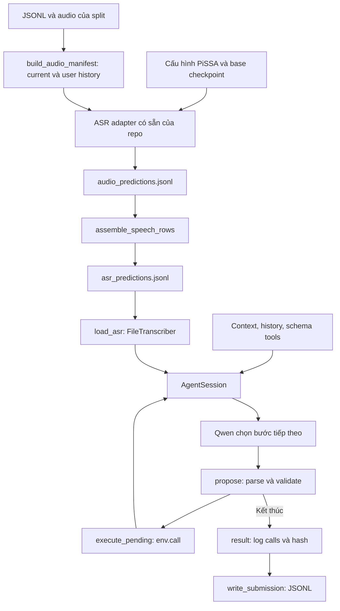

# ASR prediction → LifeMate agent

Nhánh làm việc: `agent`. Phần này nối ASR có sẵn của đội với notebook
`src/lifemate/notebooks/run_agent.ipynb`. Code xử lý nằm trong `src/lifemate/`,
notebook chỉ cấu hình và gọi module. ASR nhận audio và trả text; agent nhận text, context,
history và schema tools để quyết định hành động. Hook
`src/lifemate/agent.py::load_toolenv()` nạp thư viện BTC từ đúng split và trả
hàm tạo một ToolEnv riêng cho mỗi mẫu.

## 1. File nào làm gì?

| File | Công dụng |
|---|---|
| `src/asr/notebooks/integration/predict_asr.py` | Điểm chạy ASR: sửa đường dẫn, chạy toàn bộ split, xuất prediction cho agent. Có percent cells để dùng trên Kaggle. |
| `src/lifemate/asr/predict.py` | Dùng lại `create_adapter`, `load`, `transcribe`, `unload` của source ASR hiện tại; quản lý cache và xuất file. |
| `src/lifemate/asr/predictions.py` | Chuẩn hóa ID/history, ghép prediction thành input agent, kiểm tra file và cung cấp `FileTranscriber`. Chỉ dùng standard library. |
| `src/lifemate/agent.py` | Toàn bộ code nạp Qwen, tạo prompt, chọn/gọi tool, vòng lặp, ghi kết quả. |
| `src/lifemate/paths.py` | Đường dẫn dùng chung: ASR ghi ra đúng file mà agent đọc. |
| `src/lifemate/notebooks/run_agent.ipynb` | Import module agent, sửa cấu hình, chạy. Không có bản sao code agent trong notebook. |
| `tests/lifemate/test_predictions.py` | Test contract, prediction cache và điểm nối vào module agent bằng dữ liệu/ASR/LLM giả. |
| `tests/lifemate/test_layout.py` | Test hai launcher sau khi chuyển thư mục, kể cả đường dẫn local và Kaggle. |

## 2. Luồng tổng thể



Đây là luồng hai giai đoạn khi phát triển: chạy ASR trước, giải phóng model ASR,
rồi chạy Qwen agent. Hai giai đoạn có thể dùng môi trường Python khác nhau; file
JSONL là điểm bàn giao. Không cần thay stack ASR của bạn khác hoặc đưa SDK ASR
vào kernel agent để đọc file.

## 3. Chạy prediction ASR

Mở `src/asr/notebooks/integration/predict_asr.py`, sửa cấu hình trong `main()`:

```python
DATA_ROOT = "C:/zalo_ai/train+public_test"
SPLIT = "train"  # hoặc public_test
MODEL_PATH = None
ADAPTER_PATH = None
```

- `DATA_ROOT` chứa các thư mục split. Ví dụ Kaggle:
  `/kaggle/input/datasets/khangl123/zalo-ai/train+public_test`.
- `MODEL_CONFIG` mặc định dùng file PiSSA của repo:
  `src/asr/benchmark/configs/models/qwen_vimd_pissa_full.json`.
  Base là `Qwen/Qwen3-ASR-1.7B-hf` với revision trong config.
- `MODEL_PATH`: thư mục **base ASR** đã tải; `None` tìm trong Hugging Face cache.
  Mặc định `local_files_only=True`; chưa có base trong cache thì dừng, không tự tải.
- `ADAPTER_PATH`: thư mục adapter PiSSA đã train, có `adapter_config.json` và
  `adapter_model.safetensors`. `None` dùng đường dẫn trong `MODEL_CONFIG`.
  Cấu hình hiện có trỏ tới PiSSA full ViMD trên Kaggle. Nếu dùng lượt train ZAIC
  mới, đặt biến này tới `best_adapter/` của lượt đó. Adapter PiSSA cần là bản đã
  chuyển thành standard LoRA trên **original base**, theo code export của đội.
- `OUTPUT_DIR` lấy từ `lifemate.paths.asr_output_dir()`: local là
  `<repo>/output/lifemate/asr/<split>`, Kaggle là
  `/kaggle/working/lifemate/asr/<split>`. Agent dùng cùng helper để đọc file,
  không phụ thuộc working directory của notebook.

Chạy bằng Python của môi trường native ASR đã có trong đội:

```text
python src/asr/notebooks/integration/predict_asr.py
```

Trên Kaggle cần đưa **source mới của nhánh `asr`** vào phiên chạy và đặt
`ZAIC_PROJECT_ROOT` nếu repo nằm khác working directory.

Backend PiSSA dùng `QwenHFPEFTAdapter` của repo, tức môi trường Transformers 5 /
PEFT theo `src/asr/benchmark/requirements.txt`. Bộ baseline `qwen-asr` SDK
dùng Transformers 4.57.6 là một môi trường khác. Không có lệnh tự cài hoặc thay
PyTorch trong phần nối này.

Script mặc định chạy toàn bộ split: audio hiện tại **và mọi audio user history**.
Assistant history không cần ASR. Bộ manifest không đưa `audio_text`, `label` hoặc
`reference` vào model. Model chỉ nhận audio qua `prepare_audio()` rồi
`adapter.transcribe()`.

### Các file kết quả

```text
output/lifemate/asr/<split>/
  prediction_metadata.json    # dataset/audio SHA-256, config/model/adapter identity
  audio_predictions.jsonl     # prediction từng audio, dùng để tiếp tục khi ngắt
  asr_predictions.jsonl       # file hoàn chỉnh đưa cho agent
  errors.jsonl                # chỉ có khi gặp lỗi inference
```

`asr_predictions.jsonl` chỉ được tạo sau khi đủ prediction của toàn bộ current
và history. Mỗi dòng là một conversation:

```json
{"id":"example_0001","current_text":"Yêu cầu nhận dạng được","history_user_texts":[{"history_index":1,"text":"Lượt user trước đó nhận dạng được"}]}
```

`history_index=1` nghĩa vị trí 1 trong `history` gốc, tính từ 0 và tính cả lượt
assistant. Không có user history thì dùng `[]`. Đây là giao tiếp nội bộ nhóm;
không phải định dạng submission của BTC.

Nếu ASR lỗi, adapter được giải phóng và các audio đã xong vẫn còn trong cache.
Chạy lại cùng cấu hình để nhận dạng những audio còn thiếu. Nếu audio, split,
config hoặc adapter đã thay đổi, chọn `OUTPUT_DIR` mới để tránh trộn kết quả.

### Đã có prediction từ source cũ?

Có thể chuyển file cũ thay vì chạy inference lại:

```python
from asr.integration.predictions import convert_prediction_files

convert_prediction_files(
    data_root="C:/zalo_ai/train+public_test",
    split="train",
    prediction_paths=["current_and_history_predictions.jsonl"],
    output_path="output/lifemate/asr/train/asr_predictions.jsonl",
)
```

Chấp nhận `sample_id` + `text` của benchmark, hoặc `sample_id` + `prediction` của
fine-tuning. Trường `reference` bị bỏ qua. ID audio hiện tại là conversation ID;
audio history là `<id>_history_<index:03d>`, giống module fine-tuning.

Benchmark cũ chỉ có latest audio sẽ bị báo thiếu history; không tự điền bằng
transcript chuẩn. File validation/test từ fine-tuning cũng chỉ là một phần dữ
liệu: chỉ chuyển thành file toàn split khi đã có đủ mọi ID và mọi history.

## 4. Nối vào notebook LifeMate

Notebook tự tìm repo từ thư mục hiện tại/các thư mục cha. Có thể mở ngay trong
`src/lifemate/notebooks/`; nếu source ở chỗ khác, đặt `ZAIC_PROJECT_ROOT` trỏ tới repo.
Notebook import `lifemate.agent`, nên model chỉ nạp khi gọi runner. Trong cell chạy:

```python
report = run_full_pipeline(
    data_root=DATA_ROOT,
    split=SPLIT,
    asr_predictions_path=ASR_FILE,  # lifemate.paths.asr_prediction_file(SPLIT)
    output_dir=AGENT_OUTPUT,       # lifemate.paths.agent_output_dir()
    model_config=ModelLoadConfig(model_source=MODEL_SOURCE),
)
```

Cell cấu hình và `src/lifemate/agent.py::main()` đã comment path local/Kaggle cho
`DATA_ROOT`, `MODEL_SOURCE`, `ASR_FILE`, `AGENT_OUTPUT`. `DATA_ROOT` là thư mục
cha chứa các split; runner tự nối tên split và tên file metadata/catalog.
Đường dẫn data mặc định là `C:/zalo_ai/train+public_test` trên local và
`/kaggle/input/datasets/khangl123/zalo-ai/train+public_test` trên Kaggle.

Khi đổi split, sửa `SPLIT` rồi chạy lại cell cấu hình: `ASR_FILE` tự đổi theo
split. Nếu chuyển prediction giữa máy hoặc notebook, phải chuyển/Add Input file
rồi gán lại `ASR_FILE` tới vị trí thực tế. Agent đọc file này và không nạp model
ASR. `MODEL_SOURCE` cần là model ID đã cache hoặc thư mục Qwen/tokenizer có thật;
`local_files_only=True` giữ việc nạp LLM offline.

Kết quả agent được lưu trong `<repo>/output/lifemate/agent/<run_id>` hoặc
`/kaggle/working/lifemate/agent/<run_id>`. Qwen ở đây là **LLM agent 4B**, khác base **ASR 1.7B** của bước trước.

`load_toolenv()` trong `src/lifemate/agent.py` import đúng `zaic_tools` của split
và trả hàm `make_env(id)` gọi `ToolEnv(split, id, root=data_root)`. Nếu kernel đã
nạp thư viện của split khác, cần khởi động kernel mới. Runner chỉ tạo một
env cho mỗi mẫu. Không đọc trực tiếp `*_environment` hoặc gọi `get_state()`.

### Các function chính

| Function | Input → xử lý → output |
|---|---|
| `build_audio_manifest()` | Items + root/split → lấy current/user history đúng index → danh sách audio không có gold text. |
| `predict_lifemate()` | Config + audio manifest → nạp ASR một lần, gọi từng audio, ghi cache, unload → file prediction hoàn chỉnh. |
| `assemble_speech_rows()` | Prediction theo audio ID → kiểm tra đủ current/history → các dòng `id/current_text/history_user_texts`. |
| `FileTranscriber()` | File prediction + items → kiểm tra đủ ID/history của split → callable lấy speech theo ID. |
| `asr_output_dir()` / `asr_prediction_file()` | Một nguồn đường dẫn dùng chung cho launcher ASR và agent. |
| `load_asr()` | Root/split + prediction path → tạo FileTranscriber một lần → hàm `transcribe(audio_input)`. |
| `run_full_pipeline()` | Đọc items/tools → preflight ASR file → nạp Qwen một lần → chạy agent cho toàn split → JSONL + traces. |
| `AgentSession.__init__()` | Nhận request, ASR speech, tools, env, backend → tạo messages/trạng thái cho một yêu cầu. |
| `build_messages()` | Context/history + text ASR → prompt Qwen; không chuyển gold label. |
| `HFBackend.generate()` | Messages + schema tools → Qwen sinh bước tiếp theo. |
| `propose()` | Output Qwen → parse, kiểm tra tool/schema/ID → pending call hoặc điểm dừng. |
| `execute_pending()` | Pending call → `env.call` → thêm kết quả thật vào messages. |
| `run()` | Lặp `step → propose → execute_pending` cho tới khi dừng. |
| `result()` / `write_submission()` | Lấy log/hash từ env → ghi đúng `id/tool_calls/state_hash`. |

File ASR thiếu/sai ID, thiếu history hoặc trùng ID sẽ dừng trước khi nạp Qwen;
không dùng gold để cứu lỗi. `finished` chỉ nghĩa model tự kết thúc, chưa chứng minh
nhiệm vụ đúng. Trace và prediction ASR là file nội bộ; submission chỉ có ba trường
BTC yêu cầu và giữ mọi call đã thực thi, kể cả call bị runtime từ chối.

## 5. Kiểm tra và giới hạn

Từ repo root, đặt `PYTHONPATH=src` và chạy:

```text
python -m unittest discover -s tests/lifemate -p "test_*.py" -v
```

Test dùng WAV tự tạo, ASR giả và phản hồi LLM định sẵn để chứng minh phần nối.
Các test này không chứng minh CER/WER, chất lượng adapter hoặc quyết định Qwen.
Chạy model thật cần checkpoint/adapter và môi trường GPU tương ứng.

Nếu đặt biến môi trường `LIFEMATE_DATA_ROOT` tới dữ liệu BTC, suite chạy thêm một
test đưa speech giả qua module agent vào ToolEnv thật bằng một tool chỉ đọc. Test
này vẫn dùng phản hồi LLM định sẵn, không phải ASR/Qwen inference thật.

File ASR tính trước phục vụ phát triển/đánh giá tách phần. Thời gian đọc file trong
agent không đại diện thời gian ASR thật; khi đo end-to-end hoặc đóng gói cuối cùng,
nhóm trưởng cần chạy ASR trong runner và tính cả thời gian đó. Chưa có phép đo
30 giây/mẫu trong thay đổi này.
