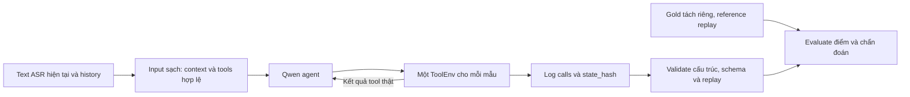

# Validate và evaluate agents

Để chạy thử trên Kaggle bằng một notebook tự chứa source Agent và evaluator,
dùng [test_lifemate.ipynb](../../notebooks/lifemate/test_lifemate.ipynb) theo
[hướng dẫn luồng thống nhất](kaggle-unified-evaluation.md). Notebook chọn 1/10/toàn
validation, dùng cùng selection cho inference và chấm điểm, giữ nguyên AgentSession.

Phần này thực hiện yêu cầu cập nhật trong chat: **chỉ thêm validation/evaluation
cho agent**. ASR của đội đã có validate/evaluate; agent đọc file text ASR có sẵn,
không tính WER/CER, không huấn luyện hoặc fine-tune ASR/LLM.



`validate` chạy sau agent, kiểm tra đầu ra và thực thi. `evaluate` đối chiếu gold
để xác định tool/arguments/state đúng hay sai. Không có annotation intent riêng,
nên chương trình dùng bằng chứng tool/arguments/state để phát hiện lỗi đọc yêu cầu;
không tự đặt một chỉ số “hiểu ngữ nghĩa” hoặc suy luận nguyên nhân ASR đã được chứng minh.

## Cấu trúc và dữ liệu

| Module | Chức năng |
|---|---|
| `evaluation/data.py` | Split 8:1:1, grouping, audio audit, input/gold riêng, verify, freeze và test gate. |
| `evaluation/runner.py` | Đọc text ASR, dùng lại `AgentSession`, một env/mẫu, lưu cả failure. |
| `evaluation/validate.py` | JSON/ID/trace/schema, replay độc lập và xác minh hash. |
| `evaluation/runtime.py` | Nạp đúng runtime BTC; reference replay; kiểm tra canonical `final_state`. |
| `evaluation/matching.py` | Exact/fuzzy và maximum bipartite matching. |
| `evaluation/evaluate.py` | Điểm từng mẫu, diagnostics, phân rã điểm mất và ưu tiên sửa. |
| `evaluation/compare.py` | So sánh paired score, bootstrap theo group. |

Lệnh có thể dùng `python -m lifemate.evaluation` hoặc `lifemate-eval` sau khi cài
package. Chỉ dùng thư viện chuẩn cho prepare/validate/evaluate/compare; chỉ lệnh
`run` với backend thật mới cần môi trường Qwen/PyTorch/Transformers sẵn có của đội.
Máy đã kiểm tra dùng `C:\Users\ACER\anaconda3\python.exe` (Python 3.13.9);
`python` chưa có trong PATH. Các ví dụ PowerShell dưới đây dùng interpreter này.

```powershell
Set-Location D:\ZAIC\ZAIC-76Vibecoders
$env:PYTHONPATH = "src"
$py = "C:\Users\ACER\anaconda3\python.exe"
$data = "D:\ZAIC\train+public_test\train+public_test"
$bundle = "output/lifemate/evaluation/agent-splits"
```

Đường dẫn dữ liệu trên đã được xác minh, thay cho đường dẫn cũ trong handoff.
Ở môi trường khác, thay `$py` và `$data`. Đây là CLI Python, không phải notebook mới.

## Prepare và verify

```powershell
# Đã tạo trên máy này. Muốn tạo lại, chọn output mới; không ghi đè thí nghiệm cũ.
& $py -m lifemate.evaluation prepare --data-root $data --output $bundle --seed 2026
& $py -m lifemate.evaluation verify --data-root $data --bundle $bundle
```

Kết quả dữ liệu thật, seed 2026:

| Tập logic | Mẫu | Hành động | Missing info | Ngoài phạm vi |
|---|---:|---:|---:|---:|
| Train | 1.236 | 974 | 173 | 89 |
| Validation | 154 | 121 | 22 | 11 |
| Local test | 155 | 122 | 22 | 11 |

Split vật lý luôn là `train`, kể cả validation/local test: gọi
`ToolEnv("train", id, root=data_root)`. Train giữ lại để đội sử dụng; code mới
không dùng nó để fine-tune LLM và không xuất thêm bộ train/evaluate ASR.

Grouping dùng metadata conversation/scenario/template/speaker nếu nguồn có,
audio trùng byte của **current và mọi user history**, hội thoại chuẩn hóa trùng
và hội thoại chỉ khác chữ số. Nguồn hiện không có metadata speaker/scenario;
không suy ra từ ID. Có 1.543 nhóm, nhóm lớn nhất 3 mẫu. Các diễn đạt gần nghĩa
khác chưa được phát hiện đầy đủ. Split phân tầng action/missing/OOS và có/không
history; audit ghi thêm app và số gold calls. Nếu không đạt chính xác tỷ lệ khi
giữ nhóm, prepare dừng báo lỗi trước khi ghi split, không tự phá nhóm.

5.036 đường dẫn WAV đều được kiểm tra tồn tại, header, thời lượng, SHA-256 và
audio–transcript conflicts. Đây là kiểm tra tính toàn vẹn dữ liệu, không đánh giá
mô hình ASR. `verify` xác minh lại fingerprint và overlap ID/group/audio bằng 0.
SHA-256 train: `24c42c79fbe8db932fe9817d041c0d0ca422ac8177b413cc1be0cda1fd8941a8`.

```text
agent-splits/
  metadata.json, integrity.json, audio_audit.json, grouping_evidence.jsonl
  train/       manifest.json, inputs.jsonl, references.jsonl
  validation/  manifest.json, inputs.jsonl, references.jsonl
  local_test/  manifest.json, inputs.jsonl, references.jsonl
```

`inputs.jsonl` chỉ có ID, đường dẫn audio, context và history hợp lệ; không có
`label`, `audio_text`, app state hoặc đáp án của lượt cuối. Assistant history
và tool results lịch sử là ngữ cảnh hợp lệ, không bị xóa. Tools lọc theo
`installed_apps`. Gold và oracle speech chỉ nằm trong `references.jsonl`.
Không đưa file này vào retrieval/prompt agent hoặc dùng local test để sửa prompt.
Code của chúng ta không mở trực tiếp `*_environment/`; chỉ thư viện BTC nạp state.

## Chạy agent trên validation

Chỉnh [cấu hình agent](../../configs/lifemate/agent-evaluation.json): model/cache
local, revision, device, ngân sách agent. `generation` là các trường `AgentConfig`;
backend hiện dùng greedy FP16. `model_revision` và `weights_fingerprint` ban đầu
là `null` vì chưa có checkpoint cụ thể được xác minh; điền trước khi freeze.

```powershell
& $py -m lifemate.evaluation run --data-root $data --bundle $bundle --split validation --speech output/lifemate/asr/train/asr_predictions.jsonl --config configs/lifemate/agent-evaluation.json --output output/lifemate/evaluation/run-dev-001
```

File speech giữ contract có sẵn `id/current_text/history_user_texts`; mỗi history
có `history_index` gốc, tính cả assistant turns. Có thể cấp cả file ASR của train
vật lý, runner chỉ chọn IDs validation. Không điền bằng transcript chuẩn nếu thiếu
ASR. Thiếu speech của một mẫu được lưu thành lỗi mẫu đó; không tạo env để thử lại.

Runner nạp Qwen một lần, dùng vòng lặp `AgentSession` hiện có, một ToolEnv/mẫu,
không reset hoặc chọn nhánh. Mọi call thực tế, kể cả bị BTC từ chối, lấy nguyên
từ log; hash lấy bằng `get_state_hash()`. Agent không nhận gold hay `get_state()`.
Các đề xuất bị chặn trước `env.call` chỉ nằm trong trace, không thêm vào log BTC.

Kết quả: `run.json` lưu config, revision, prompt/code/runtime/catalog/speech hash;
`predictions.jsonl` đúng ba trường BTC; `results.jsonl` và `traces/` lưu status,
thời gian, token usage, input speech thực sự dùng và kết quả từng tool.
Mẫu crash/timeout/limit giữ trace; nếu đã có call thì giữ log/hash. Mẫu chưa tạo
env không được giả thành `[]`. Evaluator vẫn tính mọi ID trong manifest.

`--oracle-text` thay speech ASR bằng transcript chuẩn **chỉ trên validation** để
chẩn đoán agent; không dùng `--speech` trong chế độ này. So sánh oracle và ASR
với cùng Qwen/config giúp điều tra; chênh điểm không tự xác nhận nguyên nhân ASR.
Không có lệnh oracle trên local test.

## Validate, build gold và evaluate

```powershell
& $py -m lifemate.evaluation validate --data-root $data --bundle $bundle --predictions output/lifemate/evaluation/run-dev-001/predictions.jsonl --output output/lifemate/evaluation/validate-dev-001
& $py -m lifemate.evaluation build-gold --data-root $data --bundle $bundle --output output/lifemate/evaluation/gold-dev-001
& $py -m lifemate.evaluation evaluate --data-root $data --bundle $bundle --predictions output/lifemate/evaluation/run-dev-001/predictions.jsonl --output output/lifemate/evaluation/eval-dev-001
```

`results.jsonl` hoặc `traces/` cạnh predictions được tự nhận; có thể chỉ định
`--traces`. Trace timeout/crash/step limit hoặc thiếu trace trong một bộ trace
được cung cấp làm kiểm tra runtime nghiêm ngặt thất bại. Điểm submission vẫn
dựa trên calls/hash thực tế nếu hợp lệ và replay được; runtime được báo riêng.
Nếu chỉ cấp submission ngoài không có
trace, báo `trace_coverage_checked=false`: không thể suy ra trạng thái runtime
từ một danh sách rỗng. Luồng nội bộ nên luôn giữ trace cạnh prediction.

Validation kiểm tra JSON strict (kể cả duplicate keys/NaN), ID trùng/thiếu/lạ,
fields, kiểu call, hash SHA-256, schema theo **chính `zaic_tools.schema_error`**,
tool được cài, và replay hash/log. `validate` trả exit code 1 khi có lỗi;
cấu hình/dữ liệu lỗi trả 2. Call sai schema vẫn giữ trong số submitted calls.
File có ID ngoài split/JSON lỗi được báo rõ `submission_file_valid=false`;
điểm diagnostics trên IDs dự kiến không thay thế một submission hợp lệ.

Gold hash lấy qua reference replay trong env riêng. Evaluator lấy initial state
qua API, gộp partial `label.final_state` theo app rồi dùng `zaic_tools.canon` để
đối chiếu **toàn trạng thái**. Không hash trực tiếp partial object. Bất đồng
reference/schema làm dừng chấm; không âm thầm loại mẫu khỏi mẫu số.
`build-gold` lưu bằng chứng; `evaluate` replay lại reference và predictions độc
lập, không cần tin cache gold. Dữ liệu/thư viện BTC không bị sửa.

Với `K` submitted calls, `G` gold calls, `M` số cặp ghép tối đa và `H` hash match:

```text
G = 0: score = 1 nếu K = 0, ngược lại 0
G > 0: C = 2*M/(K+G); score = H*C
FinalScore = 100 * mean(score trên toàn bộ IDs dự kiến)
Prediction thiếu/sai cấu trúc/hash không replay được: score = 0
Runtime stop status được báo riêng, không tự ép điểm submission về 0
```

Matcher tìm maximum-cardinality bipartite matching, cùng tên tool và arguments;
mỗi call chỉ ghép một lần, không xét thứ tự khi ghép. Thứ tự vẫn ảnh hưởng replay
state. `sys.ask_missing_info` được chấm cả `tool_name` và `params`, như tool khác.

Convention local: non-fuzzy so JSON đệ quy có phân biệt bool/số, key set phải
giống nhau và list giữ thứ tự; fuzzy dùng NFC + lowercase + whitespace tokens,
multiset F1 **> 0.6**, giữ dấu tiếng Việt. Tham số `--fuzzy-threshold` cho thí
nghiệm local được ghi vào report. Tài liệu BTC chưa chỉ rõ tokenizer, handling
missing/extra args và nested values; chưa có scorer chính thức để đối chiếu.
Do đó kết quả luôn ghi **`local_estimate_of_competition_score`**, cùng convention
và `official_scorer_verified=false`; không tuyên bố khớp tuyệt đối leaderboard.
File `docs/requirement/evaluation.md` hiện ghi ngưỡng `>= 0.6` và thiếu hệ số 2,
khác hình tính điểm người dùng cung cấp. Quy ước local ở trên được giữ rõ phiên
bản cho đến khi đối chiếu nguồn chính thức, không tự thay đổi khi chạy.

Subset dùng file selection riêng, không sửa integrity của bundle gốc. Truyền
cùng `--selection <selection.json>` cho `run`, `validate` và `evaluate`; nếu
không truyền, lệnh xử lý toàn logical split. Không chấm 10 prediction trên mẫu
số toàn validation. Notebook tự tạo selection qua `evaluation.selection`.

## Đọc lỗi và ưu tiên sửa

`metrics.json`: điểm trung bình từng mẫu, tool-name P/R/F1 độc lập arguments,
call-match diagnostic micro F1, missing-info P/R/F1, hash accuracy, OOS đúng/sai,
schema errors, coverage, latency p50/p95, token usage nếu có. Có slices theo
action/missing/OOS, history, độ phức tạp và installed app (các nhóm app chồng lấn).
Latency là agent với ToolEnv và text ASR cache, không phải thời gian ASR thật.

`samples.jsonl`: `K,G,M,U,H,C,score`, matched indices, missing/extra calls,
argument path và fuzzy F1, schema errors, runtime errors/status, canonical state
differences, kết quả `done=false`, rejected proposals và input audit. Cặp call
gần nhất chỉ hỗ trợ chẩn đoán, có cờ ambiguous khi nhiều cặp cùng phù hợp, không
thay đổi matcher hoặc cộng hai nguyên nhân khi chỉ sai một argument.

`report.md`: ưu tiên theo trần điểm có thể thu hồi. Các nhóm lỗi chồng lấn nên
không cộng các trần. `observed_errors` là lỗi quan sát được; `suspected_causes`
và `confirmed_causes` không được tự gán khi thiếu bằng chứng. Hash sai chỉ nói
state khác; kết luận trường cụ thể dựa trên `state_differences` từ API canonical.

Điểm mất được phân rã không trùng `L_invalid + L_hash + L_calls + L_OOS`, tổng
bằng `100 - score`. Mẫu không hợp lệ chỉ nằm trong `L_invalid`.

## So sánh và local test

```powershell
& $py -m lifemate.evaluation compare --left output/lifemate/evaluation/eval-dev-001/samples.jsonl --right output/lifemate/evaluation/eval-dev-002/samples.jsonl --output output/lifemate/evaluation/compare-dev.json
```

Hai report phải cùng ID/group. Paired bootstrap mặc định 2.000 lần, seed 2026,
lấy mẫu theo group và giữ trọng số mẫu; báo delta, CI95, mẫu tăng/giảm/không đổi.
Giữ nguyên Qwen revision/weights, prompt, quantization, catalog và generation
khi so ảnh hưởng text ASR. Không dùng điểm local test để chọn cấu hình.

Sau khi chốt cấu hình và điền revision/weights fingerprint thực tế:

```powershell
& $py -m lifemate.evaluation freeze --bundle $bundle --config configs/lifemate/agent-evaluation.json --output output/lifemate/evaluation/frozen.json
# Dùng cùng --split local_test --allow-local-test --frozen ... trên run/validate/evaluate.
# Lệnh run local_test còn yêu cầu --config trùng nguyên file đã freeze.
```

Gate kiểm tra source code và split artifact fingerprint, snapshot config, lưu
`audit.jsonl` cho mỗi lần truy cập. Đây là bảo vệ quy trình, không phải mã hóa
hoặc OS permissions. Fingerprint trọng số do đội cung cấp là provenance được
khai báo, không phải công cụ này đã băm/kiểm chứng mọi tensor model. Nếu sửa theo
lỗi test thì tập đó mất tính độc lập cho cấu hình tiếp theo. Giữ ASR upstream
cố định; fingerprint file speech dùng cho từng lượt được lưu trong `run.json`.

## Kiểm tra đã chạy

```powershell
$env:LIFEMATE_DATA_ROOT = $data
& $py -m unittest discover -s tests/lifemate -p "test_*.py" -v
```

44 tests đã qua, gồm runtime BTC thật với phản hồi model định sẵn; fixtures kiểm
tra grouping/history/leakage, schema, Unicode/threshold, maximum matching,
duplicate/missing outputs, hash tamper, runtime-vs-OOS, sample denominator,
loss decomposition, runner một env và test gate.

Reference replay trên 154 validation samples đã khớp canonical final state.
Self-check dùng gold calls để kiểm chứng evaluator đạt 100/100; **đó không phải
điểm Qwen hoặc ASR**. Artifact riêng `reference-selfcheck-verified/SELF_CHECK_ONLY.json`
ghi rõ mục đích này. Không tải model, không fine-tune, không chấm local test thật.
